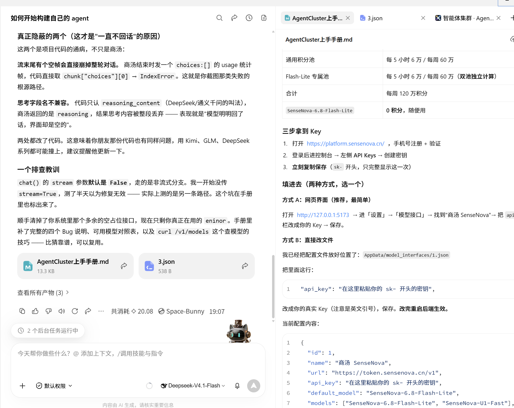
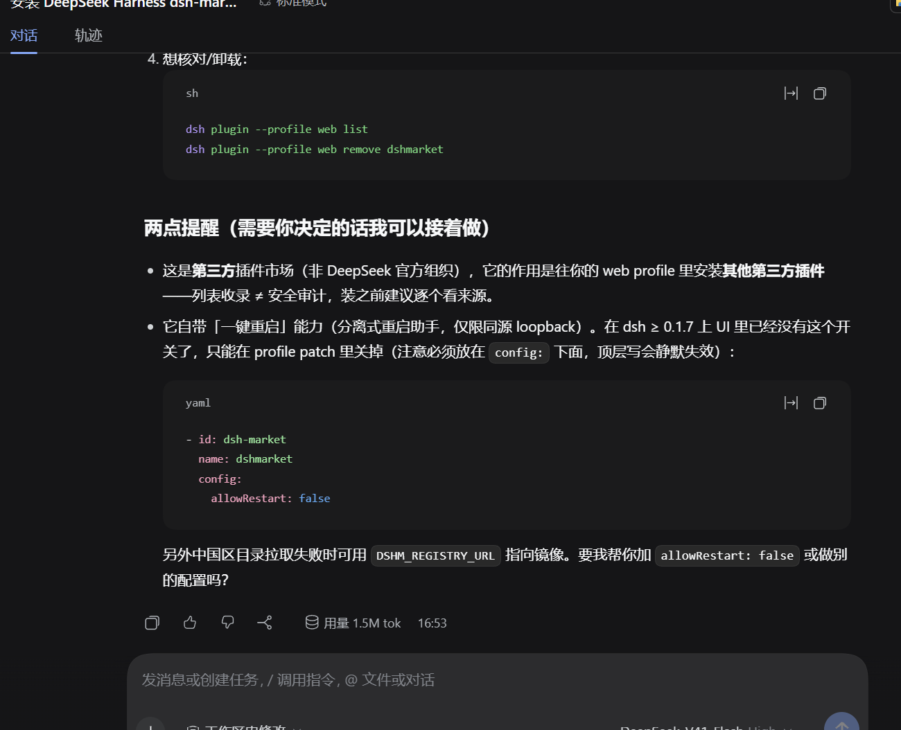

# Task 01　现代 AI 编程环境与 CLI 协同工具配置 · 作业提交

> 姓名：郝子荣　学号：2025005930　班级：软件2519
> 主机环境：Windows 11 家庭版 中文版（Build 26200）
> 说明：本文所有版本号与命令输出均为本机当场执行所得，非示例数据。

---

## 一、任务完成情况

| 任务书要求 | 状态 | 证据 |
| :--- | :-: | :--- |
| 搭建现代代码开发环境（AI 原生 IDE 或 VSCode 组合） | ✅ | 第 2 节 + 图 02 |
| 装配 VSCode 核心插件并统一设置 | ✅ | 第 2.2 节（6 个插件，含版本号） |
| 配置终端 / CLI 协同 AI 工具 | ✅ | 第 3 节 + 图 01 |
| 打通大模型 API 凭据 | ✅ | 第 4 节 |

---

## 二、现代代码开发环境

### 2.1 方案选择

两条路线我都做了实地验证，最终**并行使用**：

| 路线 | 工具 | 定位 |
| :--- | :--- | :--- |
| 方案 A：AI 原生智能工作台 | **WorkBuddy** | 承担需求拆解与多步骤任务的自动闭环，直接读写本地文件、执行命令 |
| 方案 B：经典 VSCode 组合 | **VS Code** | 承担日常编码、调试与 Markdown 写作 |

选择依据：方案 A 擅长「一次描述、多步落地」的自动化任务，方案 B 在逐行编辑与语法高亮上更可控。二者不是替代关系，而是分工。

VSCode 安装位置实测：

```powershell
PS> code --version
D:\Microsoft VS Code\bin\code
```

### 2.2 VSCode 核心插件（实测已装 6 个）

```powershell
PS> code --list-extensions
usernamehw.errorlens                 # Error Lens        错误行内高亮   v3.29.0
christian-kohler.path-intellisense   # Path Intellisense 路径智能补全   v2.10.0
esbenp.prettier-vscode               # Prettier          代码格式化     v12.4.0
formulahendry.code-runner            # Code Runner       一键运行       v0.12.2
eamodio.gitlens                      # GitLens           版本回溯       v19.3.0
ms-toolsai.jupyter                   # Jupyter           Notebook 支持  v2025.9.1
yzhang.markdown-all-in-one           # Markdown 全能（原有）
shd101wyy.markdown-preview-enhanced  # Markdown 预览增强（原有）
```

**为什么选这 6 个**（而不是把插件市场装满）：每个插件对应一个高频动作——Error Lens 把错误提示从「悬停才看到」变成「直接写在行尾」，Path Intellisense 消除手写路径的拼写错误，Prettier 保证多人协作时格式一致。插件过多会拖慢启动，只留有实际收益的。

工作区统一设置随仓库交付（`.vscode/settings.json`）：保存即格式化、Tab = 4 空格、Python 与 Markdown 独立规则。



---

## 三、终端 / CLI AI 协同工具

### 3.1 DSH（DeepSeek Harness）

```powershell
PS> npm install -g @deepseek-ai/dsh
PS> dsh --version
0.2.0-rc.2

PS> dsh --profile web --dump-config
- id: llm
  name: '@deepseek-ai/dsh-llm'
- id: session
  name: '@deepseek-ai/dsh-session'
```

凭据位于 `~/.dsh/.credentials.yaml`，其中已写入 `DEEPSEEK_API_KEY`，无需重复配置。

实际使用中还装过第三方插件市场 `dsh-market`，用于往 web profile 里挂载其他插件。这里有一个**容易踩的坑**（图 01 即该配置现场）：

`dsh-market` 自带「一键重启」能力，在 dsh ≥ 0.1.7 的 UI 上这个开关已被移除，只能在 profile patch 里关掉；并且 `allowRestart` **必须写在 `config:` 下面**，写成顶层会静默失效：

```yaml
- id: dsh-market
  name: dshmarket
  config:
    allowRestart: false
```

> 教训：配置项「写错层级」不会报错，只会不生效。这类问题不能靠「有没有报错」判断，只能靠「行为是否符合预期」验证。

### 3.2 OpenCode

```powershell
PS> npm install -g opencode-ai
PS> opencode --version
1.19.0
```



---

## 四、大模型 API 凭据打通

DSH 已内置 DeepSeek 凭据，可直接调用。OpenCode 首次使用需登录一次供应商：

```bash
opencode auth login     # 交互式选择供应商并粘贴 API Key
opencode models         # 列出可用模型，确认凭据生效
opencode run "用一句话解释 Python 的 GIL"
```

---

## 五、真实踩坑记录（3 条）

| # | 现象 | 根因定位 | 解决 |
| :-: | :--- | :--- | :--- |
| 1 | `npm install -g @deepseek-ai/dsh` 跑 12 分钟后报 `npm error code 1` | 错误栈指向 `koffi` 的 `cnoke.cjs`：`Failed to load prebuilt binary, rebuilding from source` → `CMake does not seem to be available`。`koffi` 是 DSH 部分原生插件（文件系统、目录选择器、Windows ACL 沙箱）的 FFI 依赖；其预编译二进制不覆盖本机 Node v24（ABI 137），回退源码编译又缺 CMake | DSH 主链路（CLI / profile / web）**不依赖 koffi**，实测 `dsh --version`、`dsh --profile web --dump-config` 均正常，故不必强行修复；后续真要用到原生插件再装 CMake 或降级到 Node 22 |
| 2 | `opencode-ai` 装完后 `opencode` 命令找不到 | npm 新版默认不执行依赖的 install script，提示 `1 package has install scripts not yet covered by allowScripts` | 补跑 `npm install -g --allow-scripts=opencode-ai opencode-ai`，`bin/` 下出现 180MB 的 `opencode.exe`，`opencode --version` 返回 1.19.0 |
| 3 | 全局存在指向已删除目录的 `opencode.cmd` 残留 shim，导致命令执行失败 | 上一次中断安装留下的 shim 未被清理 | 重新安装后被正确覆盖 |

---

## 六、交付物清单

| 文件 | 说明 |
| :--- | :--- |
| `task01.md` | 本文 |
| `01-DeepSeekHarness插件配置.png` | DSH 插件市场安装与 `allowRestart` 配置现场 |
| `02-WorkBuddy-Agent配置.png` | WorkBuddy 智能工作台与 Agent 协作界面 |
