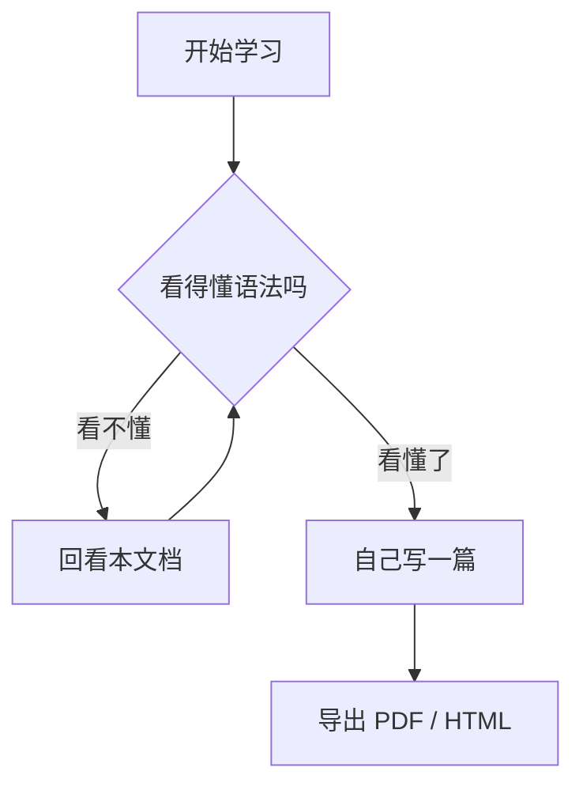

# Markdown 入门教程

> 按 `Ctrl + K` 再按 `V`（或 `Ctrl + Shift + V`）可以打开右侧预览，边写边看效果。
> 这份文件本身就是一份语法测试文件——预览时下面所有效果都是真的。

---

## 一、准备工作（环境配置）

### 1. 安装 VSCode

官网下载地址：<https://code.visualstudio.com/>

本机已安装：`D:\Microsoft VS Code\`，命令行 `code` 可直接使用。

### 2. 下载必要插件

打开 VSCode，按 `Ctrl + Shift + X` 打开扩展面板，搜索并安装：

| 插件名 | 作用 | 必装 |
| --- | --- | --- |
| **Markdown All in One** | 快捷键、自动补全、目录、格式化 | 是 |
| **Markdown Preview Enhanced** | 更强的预览，支持导出 PDF / HTML / 图片 | 是 |
| **Paste Image** | 直接粘贴截图，自动存到 `images/` 并插入链接 | 是 |
| **Markdown PDF** | 导出 PDF（中文字体容易出问题，不太推荐） | 否 |

也可以用命令行一次装完（推荐，省事）：

```bash
code --install-extension yzhang.markdown-all-in-one
code --install-extension shd101wyy.markdown-preview-enhanced
code --install-extension mushan.vscode-paste-image
```

### 3. 推荐快捷键

| 快捷键 | 功能 |
| --- | --- |
| `Ctrl + Shift + V` | 打开预览（新标签页） |
| `Ctrl + K` `V` | 打开预览（左右分屏，推荐） |
| `Ctrl + B` | 加粗（选中文字后） |
| `Ctrl + I` | 斜体 |
| `Ctrl + Shift + ]` | 提升标题级别 |
| `Ctrl + Shift + [` | 降低标题级别 |
| `Alt + Shift + F` | 一键格式化整个文档 |
| `Ctrl + Shift + P` → `Markdown Preview Enhanced: Open Preview` | MPE 预览 |
| `Ctrl + Shift + P` → `Markdown PDF: Export (pdf)` | 导出 PDF |

---

## 二、标题

`#` 的数量表示级别，最多 6 级。注意 `#` 后面要有一个**空格**。

# 一级标题
## 二级标题
### 三级标题
#### 四级标题
##### 五级标题
###### 六级标题

---

## 三、文本样式

**这是加粗**（`**加粗**`）
*这是斜体*（`*斜体*`）
***这是加粗又斜体***（`***三个星号***`）
~~这是删除线~~（`~~删除线~~`）
`这是行内代码`（用反引号包围）
==这是高亮==（部分编辑器支持）

> 这是一段引用。
> 引用可以换行继续写。
>
> > 还可以嵌套引用。

---

## 四、列表

### 无序列表

- 苹果
- 香蕉
  - 二级缩进（前面加两个空格）
  - 再一条
- 橙子

### 有序列表

1. 第一步
2. 第二步
3. 第三步

### 任务列表（待办清单）

- [x] 已完成的任务
- [ ] 未完成的任务

---

## 五、链接与图片

[这是一个链接](https://code.visualstudio.com/)

<https://code.visualstudio.com/> 直接尖括号包网址也行

引用式链接：[VSCode][1]

[1]: https://code.visualstudio.com/

图片语法和链接一样，只是前面多一个感叹号：

```markdown

```

用 Paste Image 插件的话，直接 `Ctrl + Alt + V` 粘贴截图，
图片会自动存进 `images/` 文件夹并插入好路径，不用手写。

---

## 六、代码

行内代码用一对反引号：`print("hello")`

代码块用三个反引号，并在后面写上语言名，就能高亮：

```python
def hello(name):
    print(f"你好，{name}")

hello("世界")
```

```java
public class Main {
    public static void main(String[] args) {
        System.out.println("你好，世界");
    }
}
```

---

## 七、表格

竖线 `|` 分列，第二行用 `---` 分隔表头和内容。冒号控制对齐方式。

| 左对齐 | 居中 | 右对齐 |
| :--- | :---: | ---: |
| a | b | c |
| 内容比较长一点 | 中 | 123 |
| x | y | 456 |

对齐写法： `:---` 左对齐 ／ `:---:` 居中 ／ `---:` 右对齐

---

## 八、分割线

三个及以上 `-` 或 `*` 单独占一行：

---

***

---

## 九、数学公式

Markdown Preview Enhanced 支持 LaTeX，用 `$` 包裹。

行内公式：质能方程 $E = mc^2$

独立公式：

$$
f(x) = \int_{-\infty}^{\infty} \hat{f}(\xi)\, e^{2\pi i \xi x} \, d\xi
$$

---

## 十、流程图（Mermaid）

MPE 插件内置 Mermaid，可以画流程图、时序图等。



---

## 十一、目录（TOC）

Markdown All in One 插件支持自动生成目录。

- 命令面板 `Ctrl + Shift + P` → `Markdown All in One: Create Table of Contents`
- 也可以用 `[TOC]` 占位（MPE 预览会渲染出目录）

---

## 十二、常见坑

1. **`#` 和文字之间必须有空格**，`#标题` 不会生效。
2. **代码块的反引号要用英文输入法**打，中文全角 `｀` 不认。
3. **文件名和路径避免中文和空格**，导出 PDF / 图片时容易出问题。
4. **换行**：行尾加**两个空格**再回车，或者中间空一行，才会真正换行。
5. 导出的 PDF 中文乱码的话，换用 MPE 导出，或在设置里指定中文字体。

---

*最后更新：2026-10-13*
