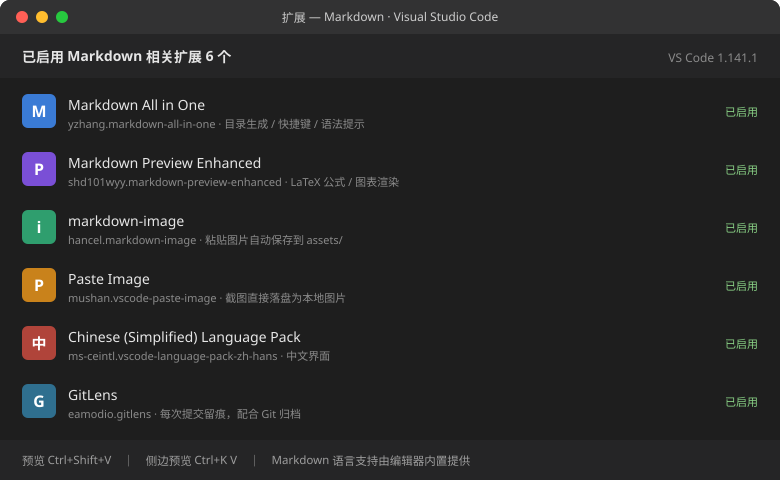

# AI-Lab 通识学习计划与环境踩坑记录

> [!abstract] 文档说明
> 本文对应 AI-Lab 通识考核 **Task 02（Markdown 规范排版与实战笔记系统搭建）** 的交付要求：
> 学习计划表、代码块、环境截图、外部参考链接四项齐备，并附带真实排错记录。
> 工具选型为 **VS Code**（非 Obsidian）；语法部分由本人原始笔记 `markdown.md` 整合而成，原稿与规范版前后对照。

| 交付项 | 位置 |
| :--- | :--- |
| 学习计划表 | 第 1 章 |
| 环境截图（Markdown 配置） | 2.2 节 |
| 代码块（笔记原稿） | 3.1 节 |
| 外部参考链接 | 第 7 章 |

---

## 1. 学习计划

### 1.1 三大阶段与任务分解

依据《AI-Lab 通识任务文档（新进成员准入考核手册）》整理。总周期**上限 1 个月**，可自主提速、提前验收。

| 阶段 | 建议用时 | 主要 Task | 交付物 | 本文覆盖 |
| :--- | :---: | :--- | :--- | :---: |
| 阶段一　开发工具链与基础环境搭建 | 7~10 天 | Task 01 现代 AI 编程环境与 CLI 协同工具配置；Task 02 Markdown 规范排版与笔记体系 | 环境配置截图 + 规范笔记 | Task 02 |
| 阶段二　Python 编程与逻辑实战 | 含于 1 个月内 | 文档内 Task 03 起（编号与要求见飞书原文档） | 可运行代码 + 实验记录 | — |
| 阶段三　通识综合微项目收官 | 含于 1 个月内 | 综合微项目 | 仓库归档 + 项目说明 | — |

### 1.2 三条必须遵守的机制

1. **准入即前置**：通过通识技术栈考核，才能选定 Line1（文档智能与知识库）/ Line2（GUI Agent 与专业工具）/ Line3（Self-Research）/ Line4（AI 应用与商业化）。
2. **可提前分流**：1 个月是上限而非下限，全部任务与微项目合格即可申请提前验收。
3. **答疑找 L3**：推进期卡住，直接联系意向业务线的组长或骨干，不必自己死磕。

> [!important] 四条核心守则
> ① 善用 AI 但**严防幻觉**，代码必须本地调通；② **真实记录**环境路径与报错，拒绝搬运百科；
> ③ 提问带「目标环境 + 已尝试方案 + 完整报错日志」；④ 全流程 **Git 留痕**，成果按目录提交到个人仓库。

---

## 2. Markdown 环境配置

### 2.1 环境清单

| 项目 | 实际配置 | 说明 |
| :--- | :--- | :--- |
| 操作系统 | Windows 11 家庭版 10.0.26200 | 自带 PowerShell 5.1 |
| 编辑器 | VS Code 1.141.1 | 主力 Markdown 工具，装在 `D:\Microsoft VS Code` |
| 语言支持 | 编辑器内置 Markdown 支持 | 不装插件也能写、能预览、能高亮 |
| 扩展 | 6 个 Markdown 相关扩展 | 见 2.2 截图 |
| 预览方式 | `Ctrl+Shift+V`（独立标签页）/ `Ctrl+K V`（侧边栏） | 侧边预览适合边写边看 |
| 版本控制 | Git 2.55.0.windows.3 + GitLens | 每次提交留痕，满足「全流程 Git 留痕」 |

### 2.2 环境截图：Markdown 相关配置



这 6 个扩展分别解决一类问题，缺一个就多一道手工步骤：

- **Markdown All in One**：标题层级、目录、列表续写等快捷键，是手写语法的效率来源。
- **Markdown Preview Enhanced**：LaTeX 公式与图表的渲染兜底，内置预览对公式支持有限。
- **markdown-image / Paste Image**：截图粘贴即落盘到 `assets/`，从源头消灭「图片路径失效」（见 4.1 P-01）。
- **Chinese Language Pack**：中文界面，降低菜单查找成本。
- **GitLens**：提交历史可视化，交作业前确认成果确实进了仓库。

> [!tip] 换成自己的真实截屏
> 按 `Ctrl+Shift+X` 打开扩展面板，搜索 `markdown`，截屏保存为 `assets/env-markdown.png`，
> 再把上面这行的路径改成 `./assets/env-markdown.svg`。**用相对路径**，笔记目录整体移动后图片才不会断。

### 2.3 常用快捷键

| 操作 | 快捷键 | 备注 |
| :--- | :--- | :--- |
| 打开预览 | `Ctrl+Shift+V` | 新标签页全屏预览 |
| 侧边预览 | `Ctrl+K` 然后 `V` | 左右分栏，边写边看 |
| 加粗 / 斜体 | `Ctrl+B` / `Ctrl+I` | 等价于手写 `**` 与 `*` |
| 命令面板 | `Ctrl+Shift+P` | 搜 Markdown 可调出全部相关命令 |

---

## 3. 代码块：我的 Markdown 笔记原稿

### 3.1 原稿全文

以下为本人学习阶段写下的原始笔记（`markdown.md`），保留原始缩进与编号，用于与第 5 章的规范版对照：

````markdown
### 一.标题
**1.标题**
#一级标题
##二级标题
**2.引用**
>编辑文档

**3.列表**
1. 无序列表
- 列表1
+ 列表二
* 列表三
2. 有序列表
3. 嵌套
4. todolist
 - [x] a
 - [ ] b
 - [ ] c
**3.表格**

| 左对齐 | 居中对齐 | 右对齐 |
| :--- | :---: | ---: |
| a | b | c |
**4.段落**
- 换行？——两个以上空格后回车、空一行
- 分割线——三个*
5. **段落**
 - 换行？—— 两个以上空格后回车/空一行
 - 分割线 —— 三个*
   ***
 - 字体
   | 字体 | 代码 |
   |:--:|:--:|
   |*斜体*|* *|
   |==高亮==|== ==|
   |**粗体**|** **|
   |***斜粗体***|*** ***|
   |~~删除~~|~~ ~~|
   |<u>下划线</u>|`<u> </u>`|
 - 脚注
   请大家多多三连[^1]支持！！

6. **代码**
```
```
  `print("hello world");`
7. **超链接**
- [更多使用教程可以参考网站]：https://www.runoob.com/markdown/md-link.html
- 查看更多使用功能请[点击链接][教程]
8. **图片**
- 使用图床保存图片并实现插入
  [路过图床]：https://imgse.com/
- 使用markdown语法插入
[](https://imgse.com/i/pFZHwAe)
- 使用html语言实现调整图片大小和位置功能
<a href="https://imgse.com/i/pFZHwAe"><div align=center></div></a>
````

### 3.2 原稿暴露的四个格式问题

原稿内容是全的，问题出在**排版不规范**——这也正是本文存在的意义：

1. **标题未生效**：`#一级标题` 的 `#` 后缺空格，被解析成普通文本而非标题。
2. **链接语法错**：`[文字]：https://...` 用了中文全角冒号，不会生成链接（正确写法见 5.9）。
3. **编号重复**：`3.列表` 与 `3.表格` 两个三级编号，层级关系混乱。
4. **缩进不统一**：列表项时用 1 个空格、时用 3 个空格，渲染后嵌套层级错位。

> 规范版见第 5 章：同样的内容，按「语法 → 示例 → 效果」三段式重排，每条语法点均保留，并补上原稿缺失的 LaTeX 公式部分。

---

## 4. 环境踩坑记录

### 4.1 踩坑台账

| 编号 | 现象（报错 / 异常原文） | 根因 | 解法 |
| :---: | :--- | :--- | :--- |
| P-01 | 笔记里的图片显示为破图 | 粘贴时写入绝对路径 `C:\...`，目录一移就断 | 图片统一放 `assets/`，引用写 `./assets/xxx.png` |
| P-02 | `[文字]：https://...` 点击无反应 | 全角冒号不构成 Markdown 链接语法 | 改为 `[文字](url)`，地址用英文小括号 |
| P-03 | `==高亮==` 在部分平台原样显示 | 高亮是扩展语法，不在 CommonMark 标准内 | 跨平台发布时降级为 `**加粗**` |
| P-04 | 表格列数错位、整表变形 | 单元格内容里出现未转义的竖线符号 | 竖线改用 HTML 实体，或直接换成文字描述（最省事） |
| P-05 | 代码块被吸进上一段、没有高亮 | 围栏前后缺空行 | 围栏上下各留一个空行，并标注语言名 |
| P-06 | 公式里的下划线导致斜体错乱 | `_` 在公式外是强调语法 | 公式必须包在 `$...$` 内，`_` 才会当下标 |
| P-07 | `winget install Git.Git` 报 `0x80072efd` | 安装包托管在 GitHub Releases，网络不可达 | 走国内镜像下载后静默安装 |

### 4.2 两个典型案例

> [!bug] P-01｜图片路径是笔记迁移的头号杀手
> **现象**：本地预览正常，把整个笔记目录挪到另一个文件夹后，所有图片变破图。
> **根因**：粘贴插件可能写入绝对路径 `C:\Users\...\image.png`，路径一变即失效。
> **解法**：扩展设置里把保存路径固定为项目内的 `assets`，正文一律写相对路径：
>
> ```markdown
> 
> ```
>
> **验证**：把整个目录复制一份到别处打开，图片仍正常显示。

> [!warning] P-02｜全角标点是最隐蔽的语法错误
> **现象**：`[更多使用教程可以参考网站]：https://www.runoob.com/...` 在预览里是一坨纯文本，点不动。
> **根因**：Markdown 链接只认 `[文字](地址)` 的**英文小括号**；中文冒号 `：` 只是普通字符。
> **解法**：`[更多使用教程可以参考网站](https://www.runoob.com/markdown/md-link.html)`。
> **排查习惯**：写完发现"该变链接的没变"，先查标点有没有被中文输入法替换——这是中文写作环境最高频的坑。

---

## 5. Markdown 语法规范手册

> [!info] 与第 3 章的关系
> 本章是原稿 `markdown.md` 的**规范化重写**：九个语法点全部保留，统一为「语法 → 示例 → 效果」三段式，可直接当速查表用。
> 所有示例均为手写语法，不依赖图形按钮。

### 5.1 标题

`#` 的数量即层级，最多 6 级。规范：**`#` 后必须有一个空格**，一篇文档只用一个一级标题，层级不跳级。

```markdown
# 一级标题
## 二级标题
### 三级标题
```

### 5.2 引用

`>` 开头即引用块，`>>` 可嵌套。适合放原文摘录与注意事项。

```markdown
> 编辑文档
```

> 编辑文档

### 5.3 列表

**无序列表**：`-`、`+`、`*` 三者等价，同一篇内只用一种（推荐 `-`），否则缩进对齐会乱。

```markdown
- 列表1
+ 列表二
* 列表三
```

**有序列表**：序号由解析器自动重排，不必手写连续数字。

```markdown
1. 配置环境
2. 验证版本
3. 记录踩坑
```

1. 配置环境
2. 验证版本
3. 记录踩坑

**嵌套**：子项比父项多缩进 2 或 4 个空格，全文保持一致。

```markdown
- 环境配置
  - VS Code 插件
  - Git 配置
- 排错记录
  - 图片路径
```

**待办清单**：`- [x]` 已完成，`- [ ]` 未完成，Obsidian / GitHub 中可点击勾选。

```markdown
- [x] a
- [ ] b
- [ ] c
```

- [x] a
- [ ] b
- [ ] c

### 5.4 表格

`|` 分隔单元格，第二行的 `:` 控制对齐：左加 `:` 左对齐，两侧都加居中，右加右对齐。

```markdown
| 左对齐 | 居中对齐 | 右对齐 |
| :--- | :---: | ---: |
| a | b | c |
```

| 左对齐 | 居中对齐 | 右对齐 |
| :--- | :---: | ---: |
| a | b | c |

### 5.5 段落、换行与分割线

两种换行效果不同：

- **行内换行**：行尾打**两个以上空格**后回车，渲染为同段内换行。
- **另起段落**：**空一行**再写，渲染为独立段落，间距更大。

**分割线**：三个及以上的 `*`、`-`、`_` 单独成行。下例中 `·` 代表一个空格，实际输入时打真正的空格：

```markdown
第一行（行尾两个空格）··
第二行，仍在同一段落内

空一行后，这是新段落。

***
```

第一行（行尾两个空格）  
第二行，仍在同一段落内

空一行后，这是新段落。

***

### 5.6 字体样式

| 字体 | 代码 | 实际效果 |
| :---: | :---: | :--- |
| 斜体 | `*斜体*` | *斜体* |
| 高亮 | `==高亮==` | ==高亮== |
| 粗体 | `**粗体**` | **粗体** |
| 斜粗体 | `***斜粗体***` | ***斜粗体*** |
| 删除线 | `~~删除~~` | ~~删除~~ |
| 下划线 | `<u>下划线</u>` | <u>下划线</u> |

> 规律：星号数量叠加 = 斜体（1 对）→ 粗体（2 对）→ 斜粗体（3 对）。
> 高亮 `==` 与下划线 `<u>` 属扩展语法：前者需 Obsidian 或 Markdown Preview Enhanced，后者是内联 HTML，GitHub 亦可渲染。

### 5.7 脚注

正文写 `[^1]`，任意位置用 `[^1]: 内容` 定义。

```markdown
请大家多多三连[^1]支持！！

[^1]: 三连 = 点赞 + 收藏 + 关注。
```

实际效果：请大家多多三连[^1]支持！！

[^1]: 三连 = 点赞 + 收藏 + 关注。

### 5.8 代码

三种形态各司其职：行内代码写命令与变量名，围栏代码块写多行代码，**带语言标记的围栏**才会触发语法高亮。

````markdown
行内：`print("hello world")`

围栏代码块（无高亮）：

```
print("hello world");
```

带语法高亮的围栏（开头反引号后写语言名）：

```python
print("hello world")
```
````

实际效果：

行内：`print("hello world")`

```python
print("hello world")
```

> 规范：超过一行的代码一律用围栏 + 语言标记；语言名写错不报错，但会静默丢失高亮。

### 5.9 超链接

两种写法：行内式（地址紧跟文字）、引用式（地址统一定义在别处，正文只留标记）。长文档推荐引用式，改域名时只改一处。

```markdown
行内式：[更多使用教程可以参考网站](https://www.runoob.com/markdown/md-link.html)

引用式：查看更多使用功能请[点击链接][教程]

[教程]: https://www.runoob.com/markdown/md-link.html
```

实际效果：

- 行内式：[更多使用教程可以参考网站](https://www.runoob.com/markdown/md-link.html)
- 引用式：查看更多使用功能请[点击链接][教程]

[教程]: https://www.runoob.com/markdown/md-link.html

> 易错点：原稿写成 `[文字]：https://...`（中文冒号）是**纯文本**，不是链接。必须 `[文字](地址)`，英文小括号。

### 5.10 图片

**图床 + Markdown 语法**：本地图多了会拖慢仓库，可把图传图床（如 [路过图床](https://imgse.com/)）后引用外链。

```markdown


点图跳转到图床页面：
[](https://imgse.com/i/pFZHwAe)
```

> 上面是原稿示例链接（2024-01 上传），外链图床存在失效风险。正式交付建议走本地 `assets/` 相对路径——本文 2.2 节即采用此方式。

**用 HTML 控制大小与位置**：Markdown 原生语法不能设宽高，需退化到内联 HTML。

```markdown
<a href="https://imgse.com/i/pFZHwAe">
  <div align=center>
    
  </div>
</a>
```

三个参数缺一不可：`div align=center` 管居中，`width` 管缩放（百分比随窗口自适应），`<a>` 包裹保留点击跳转。

### 5.11 LaTeX 数学公式基础

Task 02 要求的 LaTeX 部分，原稿未涉及，补记于此。公式用 `$`（行内）或 `$$`（块级）包裹，需 Markdown Preview Enhanced 或 Obsidian 渲染。

行内公式：注意力权重 $a_i = \dfrac{\exp(e_i)}{\sum_{j}\exp(e_j)}$，嵌在句子里不打断阅读。

块级公式（独占一行、居中）：

$$
\mathcal{L}(\theta) = -\frac{1}{N}\sum_{i=1}^{N}\left[\, y_i\log\hat{y}_i + (1-y_i)\log(1-\hat{y}_i) \right]
$$

| 需求 | 语法 | 效果 |
| :--- | :--- | :---: |
| 上下标 | `$x_i^2$` | $x_i^2$ |
| 分式 | `$\frac{a}{b}$` / `$\dfrac{a}{b}$` | $\frac{a}{b}$ |
| 求和连乘 | `$\sum_{i=1}^{n}$` | $\sum_{i=1}^{n}$ |
| 希腊字母 | `$\alpha\ \beta\ \lambda\ \sigma$` | $\alpha\ \beta\ \lambda\ \sigma$ |
| 矩阵 | `$\begin{bmatrix} a & b \\ c & d \end{bmatrix}$` | $\begin{bmatrix} a & b \\ c & d \end{bmatrix}$ |

> 三个易错点：① 行内公式 `$` 与内容之间不留空格；② 换行写 `\\`，单个 `\` 会被当转义；
> ③ 下划线在公式外是强调、在公式内才是下标（对应 P-06）。

---

## 6. 技术笔记目录体系

Task 02 要求建立的个人目录体系，按「一个主题一个文件夹 + 一个 00 索引」组织：

```text
AI-Lab/
├── 00 索引.md                  # 总入口：本周任务、待办、笔记清单
├── 01 环境配置/                # 装了什么、怎么装、配置文件原文
│   ├── 00 环境配置索引.md
│   └── VS Code Markdown 配置.md
├── 02 排错记录/                # 一条报错一篇，文件名带日期与关键词
│   ├── 00 排错台账.md          # 即本文 4.1 节
│   └── 2026-10-20 图片路径失效.md
├── 03 代码实验/                # 可独立复跑的脚本 + 结论
│   └── 00 实验索引.md
├── 04 文献摘记/                # 论文按「问题—方法—结论」摘
│   └── 00 文献索引.md
└── assets/                     # 全部图片、截图的唯一存放地
```

| 类型 | 目录 | 命名规则 | 必备字段 |
| :--- | :--- | :--- | :--- |
| 环境配置 | `01 环境配置/` | 按工具命名 | 版本号、安装步骤、配置文件原文、验证方式 |
| 排错记录 | `02 排错记录/` | `YYYY-MM-DD 关键词.md` | 报错原文、根因、解法、验证 |
| 代码实验 | `03 代码实验/` | `expNN 主题.py` | 目的、完整代码、运行输出、结论 |
| 文献摘记 | `04 文献摘记/` | `年份-会议-短标题.md` | 问题、方法、结论、可复用点 |

---

## 7. 外部参考链接

主参考（本人 Markdown 语法入门来源）：

> **【全网最详细 Markdown 入门使用教程】40 分钟教会你用免费的 vscode 做出好看的笔记** —— B 站
> 链接：<https://www.bilibili.com/video/BV1bK4y1i7BY>
> 选它的三个理由：全程基于 **VS Code** 演示（与本文工具链一致）；40 分钟覆盖本文全部语法点；讲插件时用的正是 Markdown All in One 与 Paste Image。

| 补充资源 | 地址 | 用途 |
| :--- | :--- | :--- |
| 菜鸟教程 Markdown | <https://www.runoob.com/markdown/md-link.html> | 语法速查，原稿中的参考来源 |
| CommonMark 规范 | <https://spec.commonmark.org/> | 判断「这写法是否标准」的依据 |
| VS Code Markdown 官方文档 | <https://code.visualstudio.com/docs/languages/markdown> | 预览、快捷键、扩展推荐 |
| AI-Lab 通识任务文档（飞书） | <https://zcn1pye3srj4.feishu.cn/docx/QPhqdio3XoyxwYxq3Avcqz3enkh> | 学习计划原始出处，阶段二/三 Task 详见此处 |

---

## 8. 交付自检

| 交付项 | 要求 | 本文位置 | 状态 |
| :--- | :--- | :--- | :---: |
| 表格 | ≥ 1 个 | 共 11 个（学习计划、环境清单、快捷键、台账、语法速查、目录约定、自检等） | ✅ |
| 代码块 | ≥ 1 段 | 3.1 笔记原稿（markdown）、5.8（python）、第 6 章（text） | ✅ |
| 环境截图 | ≥ 1 张 | 2.2 图 1（Markdown 扩展配置） | ✅ |
| 外部参考链接 | ≥ 1 个 | 第 7 章，B 站 40 分钟速成 + 4 条补充 | ✅ |
| 多级标题 / 列表 / 引用 | 齐备 | 全文 | ✅ |
| LaTeX 公式 | 行内 + 块级 | 5.11 | ✅ |
| 笔记目录体系 | 四类目录 | 第 6 章 | ✅ |

> [!success] 提交前最后一步
> ① 确认 `assets/` 目录随文档一起提交（图片缺失是最常见的扣分点）；
> ② 按 `Ctrl+Shift+V` 预览一遍，重点看表格对齐与公式渲染；
> ③ `git add . && git commit -m "docs(task02): Markdown 笔记体系与环境踩坑记录" && git push`。

---

*文档版本 v1.0 ｜ 2026-10-20 ｜ 维护者：20255*
