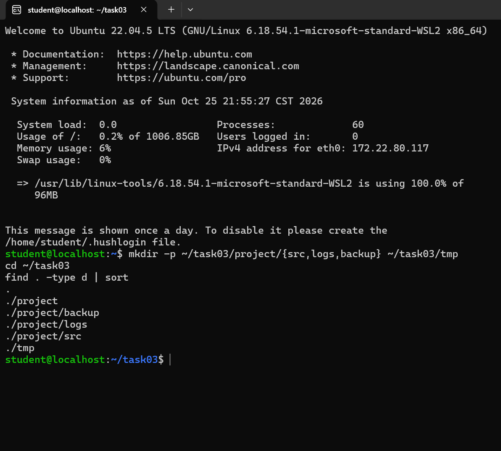
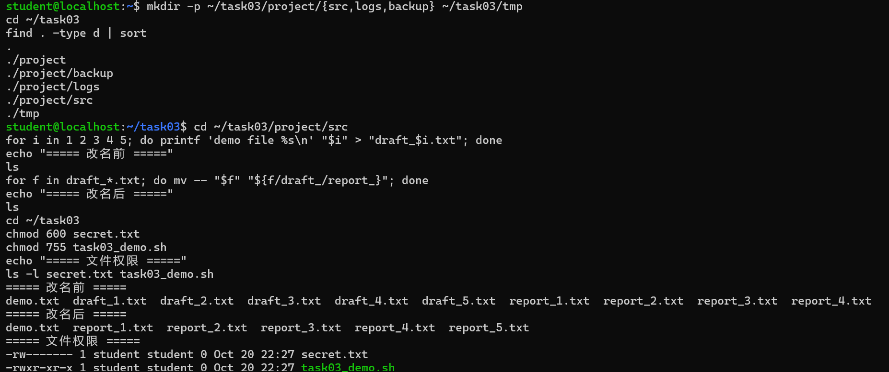
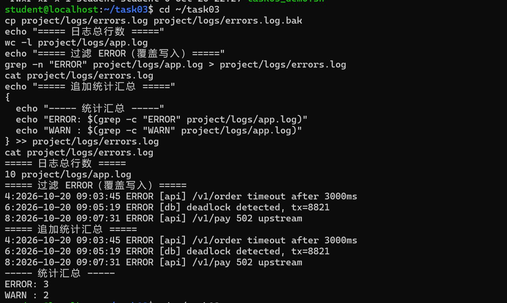
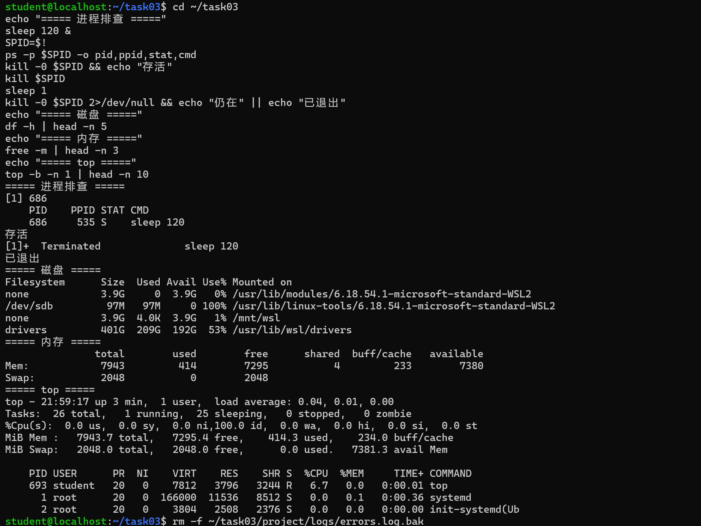

# Task 03　Linux 终端基础与常用命令行实战 · 实验报告
---

## 一、任务完成情况

| 任务书要求 | 状态 | 证据 |
|---|---|---|
| a. 目录与文件操作：`pwd` `cd` `ls` `mkdir` `rm` `cp` `mv` `cat` `head` `tail` `find` | ✅ 全部练习 | 第二节 2.1、2.5、2.6 |
| b. 文本过滤与管道：`grep` `wc` `>` `>>` `\|` | ✅ 全部练习 | 第二节 2.2 |
| c. 系统状态与进程排查：`ps aux` `top` `kill` `df -h` `free -m` | ✅ 全部练习 | 第二节 2.3 |
| d. 文件权限基础：`chmod` `chown` | ✅ 全部练习 | 第二节 2.4 |
| 交付① 创建指定目录树 | ✅ | 2.1 |
| 交付② 批量重命名文件 | ✅ | 2.5 |
| 交付③ 过滤指定日志文本并输出为新文件 | ✅ | 2.2 |
| 交付④ 执行历史 history | ✅ | 第三节 |
| 交付⑤ 截图整理为 Markdown 文档 | ✅ | 第四节 |

---

## 二、操作记录

### 2.1　创建目录树（`mkdir -p`、`find`）

```bash
mkdir -p ~/task03/project/{src,logs,backup} ~/task03/tmp
cd ~/task03
find . -type d | sort
```

**实际输出**

```
.
./project
./project/backup
./project/logs
./project/src
./tmp
```

**要点**：`-p` 使父目录自动逐级创建，且目录已存在时不报错（可重复执行）；`{src,logs,backup}` 是 shell 的**花括号展开**，在命令执行前就被拆成三个独立参数。

### 2.2　文本过滤与管道（`grep` / `wc` / `>` / `>>` / `|`）★ 交付项

先准备日志（10 行，含 3 条 ERROR、2 条 WARN），再过滤：

```bash
wc -l ~/task03/project/logs/app.log
grep -n "ERROR" ~/task03/project/logs/app.log > ~/task03/project/logs/errors.log
cat ~/task03/project/logs/errors.log
grep -c "ERROR" ~/task03/project/logs/app.log
grep "ERROR" ~/task03/project/logs/app.log | wc -l
```

**实际输出**

```
10 /home/student/task03/project/logs/app.log

4:2026-10-20 09:03:45 ERROR [api] /v1/order timeout after 3000ms
6:2026-10-20 09:05:19 ERROR [db] deadlock detected, tx=8821
8:2026-10-20 09:07:31 ERROR [api] /v1/pay 502 upstream

3
3
```

> `grep -n ... > errors.log` 这一条**屏幕无输出**，结果直接写入文件——`>` 由 shell 在命令执行前打开文件并把 fd 1 接过去，内容不经过屏幕。

追加统计汇总（区分 `>` 与 `>>`）：

```bash
{
  echo "----- 统计汇总 -----"
  echo "ERROR: $(grep -c "ERROR" ~/task03/project/logs/app.log)"
  echo "WARN : $(grep -c "WARN" ~/task03/project/logs/app.log)"
} >> ~/task03/project/logs/errors.log
cat ~/task03/project/logs/errors.log
```

**实际输出（共 6 行）**

```
4:2026-10-20 09:03:45 ERROR [api] /v1/order timeout after 3000ms
6:2026-10-20 09:05:19 ERROR [db] deadlock detected, tx=8821
8:2026-10-20 09:07:31 ERROR [api] /v1/pay 502 upstream
----- 统计汇总 -----
ERROR: 3
WARN : 2
```

**要点**：`>` 覆盖（`O_TRUNC` 先截断），`>>` 追加（`O_APPEND`）；管道 `|` 是内核缓冲区，左进程 fd 1 接右进程 fd 0，两进程并行执行。

### 2.3　系统状态与进程排查（`ps` / `kill` / `df` / `free` / `top`）

```bash
ps aux | head -n 5
sleep 120 &
SPID=$!
ps -p $SPID -o pid,ppid,stat,cmd
kill -0 $SPID && echo "存活"
kill $SPID
sleep 1
kill -0 $SPID 2>/dev/null && echo "仍在" || echo "已退出"
df -h | head -n 5
free -m | head -n 3
top -b -n 1 | head -n 12
```

**实际输出（关键判定行）**

```
存活
已退出
```

`kill -0 $SPID` 在 `kill` 之前返回成功、之后返回失败，证明进程确实已终止——这一步是本节的判据，其余 `ps` / `df -h` / `free -m` / `top` 均为标准表格输出，完整形态见第四节的截图 04。

**要点**：
- `ps aux` = 所有用户（`a`）+ 用户友好格式（`u`）+ 含无终端进程（`x`）；`STAT` 列 `S` 为可中断睡眠、`D` 为不可中断 I/O、`Z` 为僵尸。
- `kill` 是**发送信号**而非直接杀死：`-0` 仅探测，默认 `15 SIGTERM` 可被捕获（允许进程清理后退出），`9 SIGKILL` 不可捕获、为最后手段。
- `free -m` 应关注 `available` 而非 `free`，`buff/cache` 可随时回收。
- `top -b -n 1` 为批处理单帧快照，避免交互式占屏。

### 2.4　文件权限（`chmod` / `chown`）

```bash
cd ~/task03
chmod 600 secret.txt
chmod 755 task03_demo.sh
ls -l secret.txt task03_demo.sh
chown student:student ~/task03/secret.txt
```

**实际输出**

```
-rw------- 1 student student 0 Oct 20 22:53 secret.txt
-rwxr-xr-x 1 student student 0 Oct 20 22:53 task03_demo.sh
```

**要点**：`ls -l` 首列 9 位分三组对应属主 u / 属组 g / 其他 o 的 `rwx`，`r=4 w=2 x=1` 相加即数字权限：`600 = rw-------`、`755 = rwxr-xr-x`。`chmod` 只需是文件属主；`chown` 属特权操作（改为自己时无需 `sudo`）。

### 2.5　批量重命名（`for` + `mv` + 变量替换）★ 交付项

```bash
cd ~/task03/project/src
for i in 1 2 3 4 5; do printf 'demo file %s\n' "$i" > "draft_$i.txt"; done
ls
for f in draft_*.txt; do mv -- "$f" "${f/draft_/report_}"; done
ls
```

**实际输出**

```
改名前：draft_1.txt  draft_2.txt  draft_3.txt  draft_4.txt  draft_5.txt
改名后：report_1.txt report_2.txt report_3.txt report_4.txt report_5.txt
```

**要点**：`for f in draft_*.txt` 的通配符是**由 shell 展开**（不是 `mv` 展开的）；`${f/draft_/report_}` 是 bash 的变量替换，只替换第一个匹配（`//` 才是全部替换）；`--` 表示选项结束，防止文件名以 `-` 开头被误认为参数；`"$f"` 必须加引号，否则含空格的文件名会被拆成多个参数。

### 2.6　查找与查看（`find` / `cat` / `head` / `tail` / `cp` / `rm`）

```bash
find ~/task03 -type f | sort
find ~/task03 -type d -name "project"
head -n 3 ~/task03/project/logs/app.log
tail -n 2 ~/task03/project/logs/app.log
cp -v ~/task03/project/logs/app.log ~/task03/project/backup/app.log.bak
mv -v ~/task03/project/src/report_5.txt ~/task03/project/backup/
```

**实际输出（`find -type f`，共 10 个文件）**

```
/home/student/task03/project/backup/app.log.bak
/home/student/task03/project/backup/report_5.txt
/home/student/task03/project/logs/app.log
/home/student/task03/project/logs/errors.log
/home/student/task03/project/src/report_1.txt
/home/student/task03/project/src/report_2.txt
/home/student/task03/project/src/report_3.txt
/home/student/task03/project/src/report_4.txt
/home/student/task03/secret.txt
/home/student/task03/task03_demo.sh
```

**要点**：`find` 从起点递归遍历目录树，按 `-type`/`-name`/`-size` 等条件筛选；`-name` 的通配符**必须加引号**，否则被 shell 提前展开。`cp` 复制数据副本；`mv` 在同一文件系统内只改目录项（rename），不搬运数据。`rm` 无回收站，不可逆。

---

## 三、执行历史（history）

```bash
history 30 | tail -n 25 > ~/task03/history.txt
```

**节选（第 27–48 条）**

```text
 27  grep -c "ERROR" ~/task03/project/logs/app.log
 28  grep "ERROR" ~/task03/project/logs/app.log | wc -l
 29  { echo "----- 统计汇总 -----"; echo "ERROR: $(grep -c "ERROR" ...)"; ... } >> .../errors.log
 30  cat ~/task03/project/logs/errors.log
 31  ps aux | head -n 5
 32  sleep 120 &
 33  SPID=$!
 34  ps -p $SPID -o pid,ppid,stat,cmd
 35  kill -0 $SPID && echo "存活"
 36  kill $SPID
 37  sleep 1
 38  kill -0 $SPID 2>/dev/null && echo "仍在" || echo "已退出"
 39  df -h | head -n 5
 40  free -m | head -n 3
 41  top -b -n 1 | head -n 12
 42  cd ~/task03
 43  chmod 600 secret.txt
 44  chmod 755 task03_demo.sh
 45  ls -l secret.txt task03_demo.sh
 46  chown student:student secret.txt
 47  chown student:student secret.txtfind ~/task03 -maxdepth 3 | sort   （粘贴失误，已在后续单独补执行）
 48  history 30 | tail -n 25 > ~/task03/history.txt
```

完整记录（第 1–48 条）见随附文件 `history.txt`。

> **注意**：`history` 只记录交互式终端中执行的命令。若用 `bash xxx.sh` 批量执行脚本，脚本内部的命令不会进入 history——本实验采用「脚本对答案 + 手动逐条执行」两种方式，交付的历史为手动执行的真实记录。

---

## 四、操作截图

| 编号 | 内容 | 文件 | 状态 |
|---|---|:---:|:---:|
| 01 | 环境自检与目录树（`uname`、`pwd`、`find -type d`） | `screenshots/01-环境与目录树.png` | ✅ |
| 02 | 批量重命名前后（两次 `ls`）+ 文件权限（`ls -l`） | `screenshots/02-重命名与权限.png` | ✅ |
| 03 | 日志过滤（`grep -n`）与管道追加汇总（`>>`） | `screenshots/03-日志过滤与追加.png` | ✅ |
| 04 | 进程排查（`kill` 前后判定）与系统状态（`df` `free` `top`） | `screenshots/04-进程与系统状态.png` | ✅ |









---