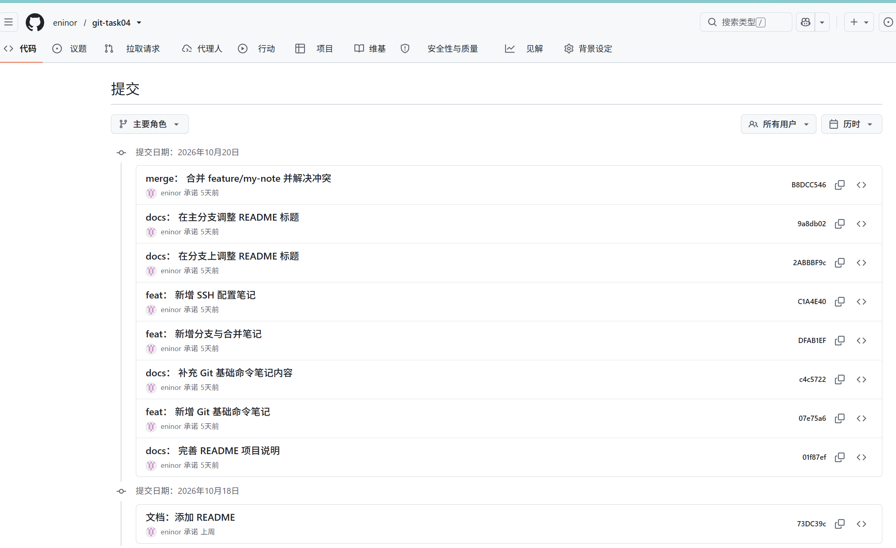

# Task 04　Git 版本管理规范与 GitHub 协作 · 作业提交

> 姓名：郝子荣　学号：2025005930　班级：软件2519
> 仓库：https://github.com/eninor/git-task04
> 说明：本文命令与输出均为本机真实执行结果。

---

## 一、任务完成情况

| 任务书要求 | 状态 | 证据 |
| :--- | :-: | :--- |
| 安装 Git 并配置全局身份 | ✅ | 第 1 节 |
| 生成 SSH 密钥并绑定到 GitHub | ✅ | 第 2 节 |
| 创建本地仓库并完成首次提交 | ✅ | 第 3 节 |
| 创建分支、提交、合并回主分支 | ✅ | 第 4 节 |
| 处理合并冲突 | ✅ | 第 4.3 节 |
| 推送到 GitHub 远程仓库 | ✅ | 图 01 |

---

## 二、Git 安装与全局身份配置

```bash
$ git --version
git version 2.55.0.windows.5

$ git config --global --list
user.email=17200678363@163.com
user.name=eninor
core.autocrlf=true
core.quotepath=false
init.defaultbranch=main
credential.helper=manager
push.default=simple
```

几个配置项的取舍说明：

| 配置项 | 取值 | 为什么这么设 |
| :--- | :--- | :--- |
| `core.autocrlf` | `true` | Windows 换行是 CRLF、Linux 是 LF。设 `true` 让 Git 在**提交时转 LF、检出时转 CRLF**，避免整个文件因换行符差异被判为「全部修改」 |
| `core.quotepath` | `false` | 设 `false` 后中文文件名在 `git status` 里正常显示，不再变成 `\344\275\240` 这种八进制转义 |
| `push.default` | `simple` | 只推送当前分支到同名上游分支，防止误推 |
| `init.defaultbranch` | `main` | 与 GitHub 默认分支名一致，省去每次 `git branch -m` |

---

## 三、SSH 密钥与 GitHub 绑定

```bash
$ ssh-keygen -t ed25519 -C "ai-lab-general@localhost"
```

生成的密钥：`C:\Users\20255\.ssh\id_ed25519`（私钥）+ `id_ed25519.pub`（公钥）。

**为什么用 ed25519 而不是 RSA**：ed25519 密钥长度短（公钥仅 68 字符 vs RSA-2048 的 400+ 字符），签名速度更快，且不存在 RSA 的小指数攻击面。GitHub 已原生支持。

### 3.1 关键问题：22 端口被屏蔽

国内网络环境下 SSH 默认的 22 端口经常无法连通，表现为 `ssh -T git@github.com` 长时间无响应后超时。解决方案是改走 HTTPS 的 443 端口——GitHub 官方为此专门提供了 `ssh.github.com` 主机名。

`~/.ssh/config` 配置：

```
Host github.com
    HostName ssh.github.com
    Port 443
    User git
    IdentityFile ~/.ssh/id_ed25519
    ServerAliveInterval 30
    ServerAliveCountMax 3
```

验证：

```bash
$ ssh -T git@github.com
Hi eninor! You've successfully authenticated, but GitHub does not provide shell access.
```

> 这行提示**不是错误**。GitHub 不提供 shell 访问，所以返回这句话；看到 `Hi <用户名>!` 就说明认证成功、公钥已正确绑定。
>
> `ServerAliveInterval 30` 与 `ServerAliveCountMax 3` 的作用：每 30 秒发一次保活包，连续 3 次无响应才断开（即最长容忍 90 秒网络抖动）。不设这两项时，网络稍有波动连接就会被中间设备静默掐断。

---

## 四、仓库操作与分支协作

### 4.1 初始化与首次提交

```bash
$ git init
$ git add README.md
$ git commit -m "docs: 添加 README"
$ git remote add origin git@github.com:eninor/git-task04.git
$ git push -u origin main
```

### 4.2 分支创建与并行修改

为了真实演练协作场景，我刻意让**主分支和特性分支修改同一行内容**，以此触发冲突：

```bash
$ git switch -c feature/my-note     # 创建并切换到特性分支
$ git commit -m "feat: 新增 SSH 配置笔记"
$ git commit -m "docs: 在分支上调整 README 标题"

$ git switch main                    # 切回主分支
$ git commit -m "docs: 在主分支调整 README 标题"
```

### 4.3 合并与冲突解决

```bash
$ git merge feature/my-note
Auto-merging README.md
CONFLICT (content): Merge conflict in README.md
Automatic merge failed; fix conflicts and then commit the result.
```

冲突文件中的标记：

```
<<<<<<< HEAD
我的第一个仓库（main 分支版）
=======
我的第一个仓库
第一次修改文件 我的feature修改版本
>>>>>>> feature/my-note
```

三个标记的含义：

| 标记 | 含义 |
| :--- | :--- |
| `<<<<<<< HEAD` | 当前分支（main）的内容起点 |
| `=======` | 两个版本的分界线 |
| `>>>>>>> feature/my-note` | 被合并分支的版本终点 |

解决方式是**手工编辑文件**，删除三个标记行，保留双方都有价值的内容；然后：

```bash
$ git add README.md
$ git commit -m "merge: 合并 feature/my-note 并解决冲突"
$ git push
```

> **一个重要教训**：冲突标记本质上只是普通文本，Git 不会阻止你把带标记的文件提交上去。一旦 `git add` 之前没检查文件内容，`<<<<<<<` 就会被当成正文永久写进历史。正确的检查动作是在 `git add` 之前执行 `git diff --check`，它会直接把冲突标记和行尾空格报出来。

### 4.4 最终提交图

```bash
$ git log --graph --oneline --all
*   b8dc546 (HEAD -> main, origin/main) merge: 合并 feature/my-note 并解决冲突
|\
| * 2abbf9c docs: 在分支上调整 README 标题
| * c1a4e40 feat: 新增 SSH 配置笔记
* | 9a8db02 docs: 在主分支调整 README 标题
|/
* dfab1ef feat: 新增分支与合并笔记
* c4c5722 docs: 补充 Git 基础命令笔记内容
* 07e75a6 feat: 新增 Git 基础命令笔记
* 01f87ef docs: 完善 README 项目说明
* 73dc39c docs: 添加 README
```

这张图能读出三件事：`dfab1ef` 是分支分叉点；`9a8db02`（main 侧）与 `2abbf9c`（分支侧）是**并行**的两次修改，不是先后关系；`b8dc546` 是合并节点，有两个父提交。



---

## 五、交付物清单

| 文件 | 说明 |
| :--- | :--- |
| `task04.md` | 本文 |
| `01-GitHub提交记录.png` | GitHub 网页端展示的完整提交历史（含合并提交） |
| 远程仓库 | https://github.com/eninor/git-task04 |
