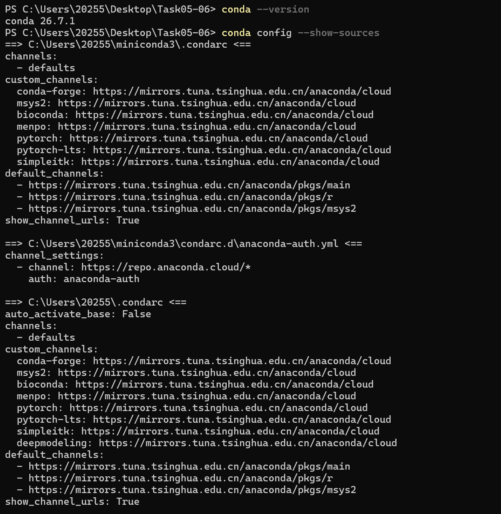
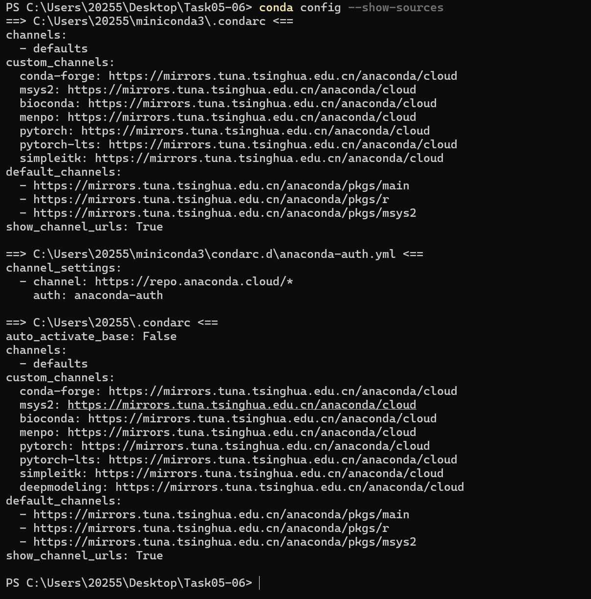
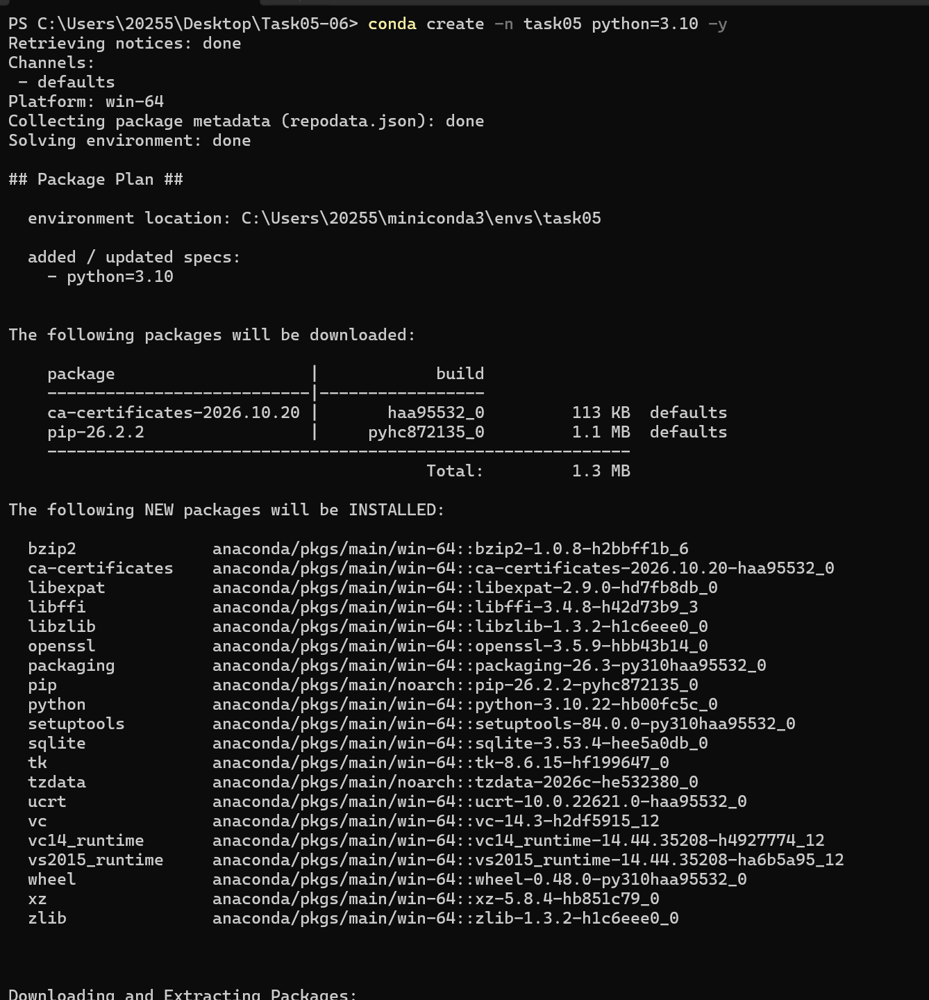
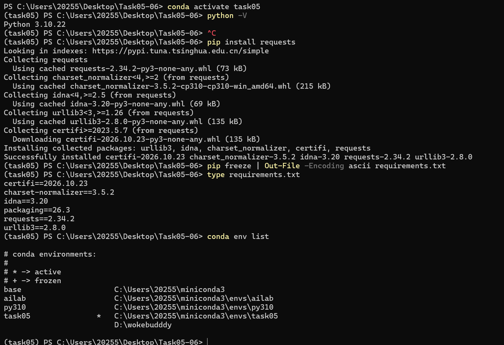

# Task 05　Conda 虚拟环境隔离与镜像源加速配置 · 作业提交

> [!abstract] 文档说明  
> 本文是**本人亲手执行**的完整记录：版本号、路径、命令输出均来自真实终端，截图存于 `screenshots/` 目录。  
> 执行时间 2026-10-25 21:03–21:14；环境：Windows 11 家庭版 + Miniconda 26.7.1 + PowerShell 5.1。  
> 演示环境名 **`task05`**，Python **3.10.22**。

| 任务书要求                            |  状态 | 证据                                |
| :------------------------------- | :-: | :-------------------------------- |
| a. 安装 Miniconda（推荐）或 Anaconda    |  ✅  | 第 1 节 + 图 01                      |
| b. 配置国内镜像源，加速 conda 与 pip 下载     |  ✅  | 第 2 节 + 图 02、图 04                 |
| c. 掌握核心环境管理命令                    |  ✅  | 第 3、4 节 + 图 03、图 04               |
| d. 依赖导出与复现                       |  ✅  | 第 5 节 + 图 04 + `requirements.txt` |
| **交付**：镜像源配置截图                   |  ✅  | 图 02（conda）+ 图 04（pip）            |
| **交付**：创建指定 Python 版本独立环境        |  ✅  | 图 03 + 图 04（`(task05)` + 3.10.22） |
| **交付**：导出 requirements.txt 的操作记录 |  ✅  | 图 04 + `requirements.txt` 实体      |

---

## 1. 安装确认（对应 a）

```powershell
PS C:\Users\20255\Desktop\Task05-06> conda --version
conda 26.7.1
```

| 项目       | 实际值                              |
| :------- | :------------------------------- |
| 发行版      | Miniconda（任务书推荐项）                |
| 安装路径     | `C:\Users\20255\miniconda3`      |
| 版本       | conda 26.7.1                     |
| 默认环境自动激活 | 已关闭（`auto_activate_base: False`） |

> 关掉自动激活是刻意选择：新开终端停在 `base`，只有手动 `conda activate` 才进环境。  
> 这样每个包的落点由人决定，不会被"默认环境"悄悄改掉。



---

## 2. 镜像源配置（对应 b）

conda 与 pip 是**两条独立通道**，必须分别配置、分别验证。

### 2.1 conda 通道

配置文件 `C:\Users\20255\.condarc`（用户级）与 `C:\Users\20255\miniconda3\.condarc`（安装级）内容一致：

```yaml
channels:
  - defaults
show_channel_urls: true
auto_activate_base: false
default_channels:
  - https://mirrors.tuna.tsinghua.edu.cn/anaconda/pkgs/main
  - https://mirrors.tuna.tsinghua.edu.cn/anaconda/pkgs/r
  - https://mirrors.tuna.tsinghua.edu.cn/anaconda/pkgs/msys2
custom_channels:
  conda-forge: https://mirrors.tuna.tsinghua.edu.cn/anaconda/cloud
  msys2: https://mirrors.tuna.tsinghua.edu.cn/anaconda/cloud
  bioconda: https://mirrors.tuna.tsinghua.edu.cn/anaconda/cloud
  menpo: https://mirrors.tuna.tsinghua.edu.cn/anaconda/cloud
  pytorch: https://mirrors.tuna.tsinghua.edu.cn/anaconda/cloud
  pytorch-lts: https://mirrors.tuna.tsinghua.edu.cn/anaconda/cloud
  simpleitk: https://mirrors.tuna.tsinghua.edu.cn/anaconda/cloud
  deepmodeling: https://mirrors.tuna.tsinghua.edu.cn/anaconda/cloud
```

验证命令与输出（`--show-sources` 显示 conda 实际加载了哪些配置，比直接翻文件更可靠）：

```powershell
PS C:\Users\20255\Desktop\Task05-06> conda config --show-sources
==> C:\Users\20255\miniconda3\.condarc <==
channels:
  - defaults
custom_channels:
  conda-forge: https://mirrors.tuna.tsinghua.edu.cn/anaconda/cloud
  ...
default_channels:
  - https://mirrors.tuna.tsinghua.edu.cn/anaconda/pkgs/main
  - https://mirrors.tuna.tsinghua.edu.cn/anaconda/pkgs/r
  - https://mirrors.tuna.tsinghua.edu.cn/anaconda/pkgs/msys2
show_channel_urls: True
```



### 2.2 pip 通道

配置文件 `%APPDATA%\pip\pip.ini`：

```ini
[global]
index-url = https://pypi.tuna.tsinghua.edu.cn/simple
trusted-host = pypi.tuna.tsinghua.edu.cn
```

运行时验证（比看配置文件更有说服力——终端确实走了清华源）：

```powershell
PS C:\Users\20255\Desktop\Task05-06> pip install requests
Looking in indexes: https://pypi.tuna.tsinghua.edu.cn/simple
```

`Looking in indexes:` 这行是 pip 镜像生效的直接证据，见图 04。

---

## 3. 创建指定 Python 版本的独立环境（对应 c）

```powershell
PS C:\Users\20255\Desktop\Task05-06> conda create -n task05 python=3.10 -y
```

输出中的关键信息：

```text
## Package Plan ##

  environment location: C:\Users\20255\miniconda3\envs\task05

  added / updated specs:
    - python=3.10

The following NEW packages will be INSTALLED:
  ...
  python            anaconda/pkgs/main/win-64::python-3.10.22-hb00fc5c_0
  ...

Preparing transaction: done
Verifying transaction: done
Executing transaction: done
#
# To activate this environment, use
#
#     $ conda activate task05
```

两点值得记录：

1. `environment location: ...\envs\task05` —— 环境是独立目录，与 `base` 完全隔离。
2. `python-3.10.22` 来自 `anaconda/pkgs/main/win-64` —— 走镜像源的 win-64 分支，装的是**编译好的 Windows 二进制包**，无需现场编译。



---

## 4. 激活与版本验证（对应 c）

```powershell
PS C:\Users\20255\Desktop\Task05-06> conda activate task05
(task05) PS C:\Users\20255\Desktop\Task05-06> python -V
Python 3.10.22
```

**判断是否真的进入环境，只看一个标志：提示符前是否出现 `(task05)`。**

| 提示符                   | 含义          | `pip install` 会装到哪                      |
| :-------------------- | :---------- | :-------------------------------------- |
| `PS C:\...>`          | 未激活         | 系统 Python `D:\python大一`                 |
| `(task05) PS C:\...>` | 已在 task05 内 | `C:\Users\20255\miniconda3\envs\task05` |

这正是本任务的核心：**同一台机器上，`pip install` 装到哪儿，取决于当前激活的是哪个环境。**

---

## 5. 安装依赖、导出与复现（对应 d）

### 5.1 装包

```powershell
(task05) PS C:\Users\20255\Desktop\Task05-06> pip install requests
Looking in indexes: https://pypi.tuna.tsinghua.edu.cn/simple
Collecting requests
  Using cached requests-2.34.2-py3-none-any.whl (73 kB)
Collecting charset_normalizer<4,>=2 (from requests)
  Using cached charset_normalizer-3.5.2-cp310-cp310-win_amd64.whl (215 kB)
Collecting idna<4,>=2.5 (from requests)
  Using cached idna-3.20-py3-none-any.whl (69 kB)
Collecting urllib3<3,>=1.26 (from requests)
  Using cached urllib3-2.8.0-py3-none-any.whl (135 kB)
Collecting certifi>=2023.5.7 (from requests)
  Downloading certifi-2026.10.23-py3-none-any.whl (135 kB)
Installing collected packages: urllib3, idna, charset_normalizer, certifi, requests
Successfully installed certifi-2026.10.23 charset_normalizer-3.5.2 idna-3.20 requests-2.34.2 urllib3-2.8.0
```

注意 `cp310-cp310-win_amd64.whl`：包名里的 `cp310` 表示它专为 CPython 3.10 + Windows x64 编译。  
换成别的 Python 版本会自动挑另一个 wheel——这正是虚拟环境要隔离的东西。

### 5.2 导出

```powershell
(task05) PS C:\Users\20255\Desktop\Task05-06> pip freeze | Out-File -Encoding ascii requirements.txt
(task05) PS C:\Users\20255\Desktop\Task05-06> type requirements.txt
certifi==2026.10.23
charset-normalizer==3.5.2
idna==3.20
packaging==26.3
requests==2.34.2
urllib3==2.8.0
```

> **为什么不用 `pip freeze > requirements.txt`？** Windows PowerShell 5.1 的 `>` 默认写 **UTF-16LE** 编码，文件头带 `FF FE` BOM；  
> 而 `pip install -r` 按 UTF-8 读取，遇 BOM 可能报 `Invalid requirement`。  
> `Out-File -Encoding ascii` 输出纯 ASCII，跨平台跨版本都稳；包名与版本号本身只有 ASCII 字符，无信息损失。

### 5.3 复现

```powershell
conda create -n task05_new python=3.10 -y
conda activate task05_new
pip install -r requirements.txt
```

`==` 锁死版本是关键：只写包名不写版本，明天装出来可能是另一个版本，复现就失效。

### 5.4 环境总览

```powershell
(task05) PS C:\Users\20255\Desktop\Task05-06> conda env list

# conda environments:
#
base                     C:\Users\20255\miniconda3
ailab                    C:\Users\20255\miniconda3\envs\ailab
py310                    C:\Users\20255\miniconda3\envs\py310
task05                *  C:\Users\20255\miniconda3\envs\task05
                         D:\wokebudddy
```

`*` 标注当前激活的环境。四个环境各自独立、互不影响。



---

## 6. 踩坑记录：一次真实的"环境污染"

这一节不是凑字数，而是本任务最直接的例证。

**现象**：第一次操作时把两条命令写进同一行：

```powershell
conda activate task05 → python -V
```

PowerShell 报错：

```text
Enter-CondaEnvironment : 找不到接受实际参数"→"的位置形式参数。
所在位置 C:\Users\20255\miniconda3\shell\condabin\Conda.psm1:173 字符: 17
+                 Enter-CondaEnvironment @OtherArgs;
+ CategoryInfo          : InvalidArgument: (:) [Enter-CondaEnvironment], ParameterBindingException
+ FullyQualifiedErrorId : PositionalParameterNotFound,Enter-CondaEnvironment
```

**原因**：`→` 是笔记中表示「然后」的记号，不属于命令。整行被当成一条命令执行，`→` 成了多余的位置参数，  
于是**整行失败、`conda activate` 未生效**。

**后果**：紧接着的 `pip install requests` 在未激活任何环境的情况下执行，装进了系统 Python：

```text
[notice] To update, run: D:\python大一\python.exe -m pip install --upgrade pip
```

这行提示里的 `D:\python大一` 暴露了实际解释器。事后核实：`D:\python大一\Lib\site-packages\requests-2.34.2.dist-info`  
时间戳为 2026-10-25 21:08，确实装错了位置；而 `envs\task05` 当时只有 pip / setuptools / wheel / packaging。

**纠正**：分两次回车，先 `conda activate task05`，确认提示符出现 `(task05)` 后再敲 `python -V`，然后重新装包。图 04 为纠正后的正确过程。

**三条结论**：

1. **命令必须逐条执行**，不要把多条命令拼成一行（管道 `|` 例外，那是一个整体）。
2. **提示符前缀 `(环境名)` 是唯一可靠的环境判据**，不能凭感觉。
3. 虚拟环境的价值正在此处：包全堆在系统 Python 里，装错、版本打架只能重装整个解释器；  
   而在 `task05` 里装坏了，`conda remove -n task05 --all` 一条命令就回到干净状态。

---

## 附录　文件清单

| 文件                            | 说明                                         |
| :---------------------------- | :----------------------------------------- |
| `Task05-作业提交.md`              | 本文                                         |
| `requirements.txt`            | `task05` 环境导出的真实依赖清单（6 项）                  |
| `screenshots/01-conda版本.png`  | `conda --version` → 26.7.1                 |
| `screenshots/02-conda镜像源.png` | `conda config --show-sources` → 全屏 tuna 域名 |
| `screenshots/03-创建环境.png`     | `conda create -n task05 python=3.10`       |
| `screenshots/04-完整流程.png`     | 激活 → 装包 → 导出 → `conda env list`            |
| `Task05-实操清单.md`              | 逐步操作与截图点位说明（过程记录，非交付必需）                    |
| `_parked/`                    | Task 06 相关内容暂存，本次不提交                       |
